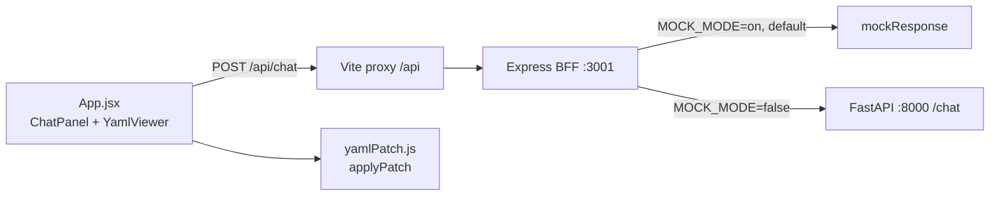

# YAML Chat Editor

A small React prototype for editing YAML by describing the change in plain language.

The left pane is a turn-based chat (your messages on the right, the agent's replies on the
left). The agent replies with a **patch preview**, never with an edit. The right pane shows
the YAML, and it only changes when you click **Apply changes**.



## Running it

```bash
cd frontend
npm install
npm start          # Vite on :5173 and the BFF on :3001
```

Open <http://localhost:5173>. Mock mode is the default, so it works with no backend running.
The chat header shows a **Mock mode** badge when responses are mocked.

To point at a real FastAPI service:

```bash
MOCK_MODE=false FASTAPI_URL=http://localhost:8000 npm start
```

| Variable      | Default                 | Purpose                      |
| ------------- | ----------------------- | ---------------------------- |
| `PORT`        | `3001`                  | BFF port                     |
| `FASTAPI_URL` | `http://localhost:8000` | FastAPI base URL             |
| `MOCK_MODE`   | `true`                  | `false` = forward to FastAPI |

## The FastAPI contract

The browser never talks to FastAPI. `frontend/server.js` is the only place the contract lives.

**Browser → BFF** — `POST /api/chat`

```json
{
  "message": "add a container called UI2",
  "yaml": "models:\n  containers: []\n"
}
```

`message` must be a non-empty string and `yaml` must be a string; otherwise the BFF replies
`400` with a human-readable `reply`.

**BFF → FastAPI** — `POST {FASTAPI_URL}/chat` with the same `{ message, yaml }` body.

**FastAPI → BFF → browser**

```json
{
  "reply": "Added a UI2 container.",
  "patch": [
    { "op": "add", "path": "/models/containers/-", "value": { "id": "UI2" } }
  ]
}
```

- `reply` — text shown in the agent bubble.
- `patch` — a list of operations, or `null` when the request needs no change.

Each operation is:

| Field   | Type                             | Notes                                            |
| ------- | -------------------------------- | ------------------------------------------------ |
| `op`    | `"add" \| "remove" \| "replace"` | Anything else is rejected                        |
| `path`  | `string`                         | JSON pointer; `-` as the last segment appends    |
| `value` | any                              | Needed for `add`/`replace`, omitted for `remove` |

`GET /api/health` returns `{ "mock": boolean, "fastapiUrl": string }` and drives the header badge.

If FastAPI's shape changes, `server.js` is the single seam to edit — see the line marked
`CONTRACT` in `POST /api/chat`.

### Why a patch instead of a new document

Returning the whole document would make review impossible: the diff is invisible, and a bad
response silently rewrites everything. Operations are explicit and are shown to the user one
by one before anything is applied.

`applyPatch` is strict on purpose. An unknown `op`, an out-of-range index, or a missing
intermediate key throws, and the card is marked **Discarded** with the reason rather than
applying a partial edit. `replace` on a key that does not exist is an error; `add` creates it.

## Tests

```bash
npm test           # single run
npm run test:watch # watch mode
```

74 tests across 6 files (`src/test/`):

| File                  | Covers                                                |
| --------------------- | ----------------------------------------------------- |
| `yamlPatch.test.js`   | patch application, pointer escaping, every error path |
| `api.test.js`         | request shape, non-2xx and malformed-body handling    |
| `server.test.js`      | BFF validation, mock keywords, FastAPI forwarding     |
| `ChatPanel.test.jsx`  | composing, quick actions, apply/discard wiring        |
| `YamlViewer.test.jsx` | line numbers, change highlighting, copy               |
| `App.test.jsx`        | the full flow: nothing changes until Apply            |

## How it works

`App.jsx` owns the state and the rule that matters: **the YAML only changes inside
`handleApply`.** A reply with a patch renders a `PatchCard` in `pending` state; nothing else
touches `yamlText`.

Each apply pushes the prior YAML onto an undo stack (capped at 20), which also gives
`YamlViewer` the "before" text it needs to highlight changed lines. Highlighting uses a
longest-common-subsequence diff rather than a set difference of line strings, so repeated
lines are not falsely marked and a changed line is never missed.
