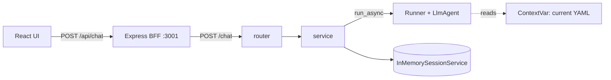

# YAML Agent Backend

FastAPI + [Google ADK](https://adk.dev/) service behind the YAML chat editor.
The agent reads a YAML document plus a chat request and replies with a short
message and a **patch** (`add` / `remove` / `replace` ops on JSON-Pointer paths).
The UI shows the patch as a preview; the YAML only changes when the user applies it.

## Commands

Run from `backend/` (this folder is a [uv](https://docs.astral.sh/uv/) project):

- `uv sync --group dev` — install dependencies
- `uv run pytest` — run the test suite (no `GOOGLE_API_KEY` needed)
- `MOCK_MODE=true uv run uvicorn main:app --reload --port 8000` — run without calling Gemini
- `uv run uvicorn main:app --reload --port 8000` — run against the real model (needs a key)

Copy `.env.example` to `.env` and set `GOOGLE_API_KEY` from
[aistudio.google.com/apikey](https://aistudio.google.com/apikey).

To drive the UI against this backend, start the frontend with
`MOCK_MODE=false FASTAPI_URL=http://localhost:8000 npm start`.

## Sessions

`session_id` identifies one conversation. It is **optional on the way in** and
**always present on the way out**:

- Omit it → the service mints a `uuid4` and returns it.
- Send it back → the same conversation resumes.

The UI stores the id in `sessionStorage`, so a page reload keeps the
conversation. Sessions live in ADK's `InMemorySessionService`, which means they
are lost when the server restarts — fine for the prototype, not for production.

## The YAML is not in the history

The document is passed on **every** request, so storing it as part of the
message would grow history without bound and re-send it on every turn.

Instead `agent.py` holds the current document in a `ContextVar` and injects it
into the system instruction via `build_instruction`. Only the user's message is
appended to the session. `tests/test_service.py` asserts both halves of this:
the document reaches the instruction, and never appears in a stored event.

## Layout

| File                                   | Role                                                       |
| -------------------------------------- | ---------------------------------------------------------- |
| `main.py`                              | App definition and router registration                     |
| `src/yaml_agent/schema.py`             | Request/response models and the agent's output schema      |
| `src/yaml_agent/agent.py`              | `LlmAgent` definition and instruction builder              |
| `src/yaml_agent/service.py`            | Session lifecycle, runs the agent, converts output         |
| `src/yaml_agent/router.py`             | HTTP layer                                                 |
| `src/yaml_agent/prompts/yaml_agent.md` | System prompt template                                     |
| `src/yaml_agent/mock_runner.py`        | Canned stand-in for `Runner` used by `MOCK_MODE` and tests |

## Testing

Tests never call Gemini. `MockRunner` mirrors the part of `Runner` the service
uses, and yields real ADK `Event` objects so the production code path is
exercised as-is. It also appends to the session store, so history-dependent
behaviour is testable.

Tests are named `test_<feature>_<scenario>_<expected>`, per `.instructions.md`.
